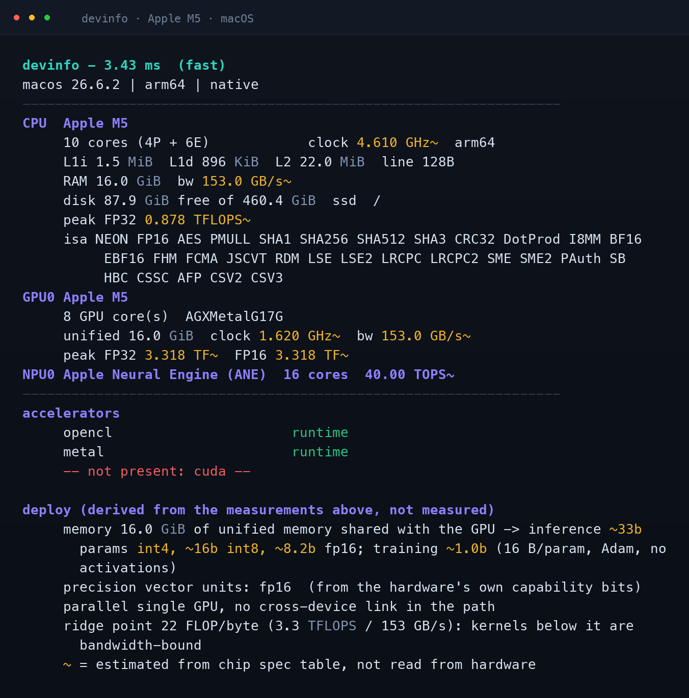
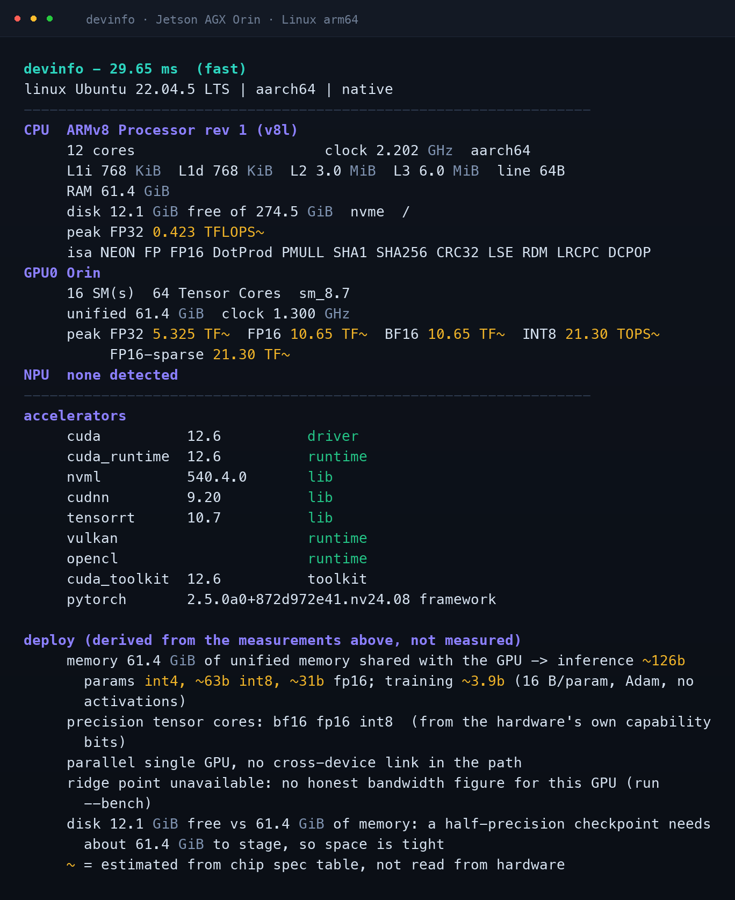
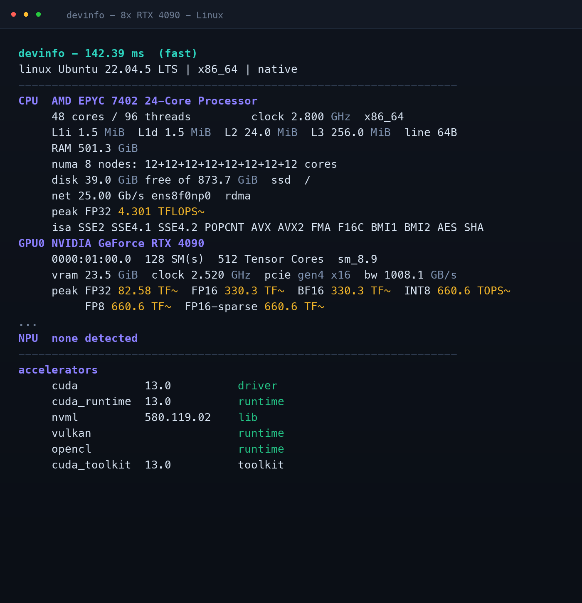

<p align="center">
  <b>devinfo</b><br>
  一个二进制，读出任何机器的真实硬件<br>
  <sub>one binary · any machine · no subprocess · 3 ms</sub>
</p>

<p align="center">
  <a href="README_EN.md">English</a> &nbsp;｜&nbsp; <b>中文</b>
</p>

<p align="center">
  
  
  
  
  
  
</p>

> 把一个静态链接的 C++17 二进制丢到任何一台陌生机器上跑一次，它就告诉你：CPU 有几个核、缓存多大、支持哪些指令集，GPU 有多少 SM 和 Tensor Core、什么架构、显存和带宽多少，NPU 算力多少，装了哪些加速栈，PCIe 跑在第几代，以及**这块机器能跑多大的模型**。
>
> 3 毫秒。零第三方依赖。不调用任何子进程。

## 🖼️ 输出预览

| Apple M5 · macOS arm64 | Jetson AGX Orin · Linux aarch64 |
|:---:|:---:|
|  |  |

| 2× EPYC 7402 + 8× RTX 4090 · Linux x86_64 |
|:---:|
|  |

图中带 `~` 的数字是**从芯片规格表推算的**，不是从硬件读出来的，统一显示为琥珀色。没有任何数字是凭空填的。

### 静态展示页

`site/` 是一个不依赖任何 CDN 的静态站点：`site/index.html` 是产品页，`site/results.html` 是四台真实机器的实测记录（由 `tools/build_results.py` 从 `assets/captures/*.txt` 生成，原始输出逐字节注入，不会和程序实际打印的内容脱节）。

本地直接打开：

```bash
python3 -m http.server 19090 --directory site
# 打开 http://127.0.0.1:19090/
```

纯静态，没有构建步骤。同样的内容也在 `gh-pages` 分支上（站点在分支根目录），在仓库 **Settings → Pages** 里把 Source 设为该分支即可对外访问。

## 📝 简介

devinfo 不是"又一个硬件信息脚本"。它回答的是**部署前必须知道的那些问题**，而且只回答它真的能读到的部分：

- 这块卡是 **sm_89** 还是 **sm_87**？能不能吃 FP8？
- 显存是 **23.5 GiB 独立内存** 还是 **61.4 GiB 统一内存**？后者不能当显存单独算。
- 8 张卡是**同型号可合并成 186.6 GiB 内存池**，还是**两种不同型号只能各跑各的**？
- 带宽是 **1008 GB/s** 还是根本没读到？roofline 拐点在 82 FLOP/byte 还是算不出来？
- 这台机器装了 **CUDA 13.0 + cuDNN 9.20 + TensorRT 10.7**，还是只有驱动？
- 我在容器里，看到的 96 个核里有 **多少是我能用的**？

输出只有三种：给人看的表（`--table`）、给程序看的 JSON（`--json`）、给别的语言调用的 C ABI（`libdevinfo.so` / `.dylib` / `devinfo.dll`）。

## ✨ 能读到什么

### 1. CPU 与缓存

- 物理核 / 逻辑线程、性能核与能效核拆分（Apple Silicon、Intel 12 代以后的混合架构）；
- L1i / L1d / L2 / L3、缓存行大小；
- 频率：能读到就报实测值，读不到才用规格表推算并标 `~`；
- 完整 ISA 位图：x86 从 SSE2 / SSE4.1 / **SSE4.2** / AVX / AVX2 / AVX-512 / FMA / AES / SHA，ARM 从 NEON / FP16 / DotProd / I8MM / BF16 / SVE / SME / SME2；
- NUMA 节点划分。

峰值算力由**核心数 × 频率 × 每周期浮点操作数**算出，其中每周期浮点数按 ISA 决定（AVX-512 = 64、AVX2 = 32、SSE/NEON = 16 FLOP/cycle），所以不会出现"只有一半"这种经典错误。

### 2. GPU 与 NPU

- 型号、PCI 地址、PCI ID（`1002:6987` 这种，能对上驱动支持列表）；
- **SM 数量**、**Tensor Core 数量**、计算能力（`sm_8.9`）；
- 显存容量，以及它到底是**独立显存**还是**统一内存**（CUDA 的 `integrated` 属性判定，不是靠型号猜）；
- 显存频率、总线宽度、由此算出的带宽；
- 各精度峰值：FP32 / FP16 / BF16 / INT8 / FP8 / FP16-sparse，按架构的 Tensor Core 规格推导；
- NPU：Apple ANE 的核心数与 TOPS、昇腾 / 寒武纪通过 CANN dlopen 读取。

### 3. 加速栈

只 `dlopen`，不链接、不执行：

| 栈 | 探测方式 |
|---|---|
| CUDA / cuDNN / TensorRT / NCCL / NVML | `libcudart` / `libcudnn` / `libnvinfer` / `libnccl` / `libnvidia-ml`，版本从符号或文件读 |
| ROCm / HIP | `libamdhip64`、`librocblas` |
| CANN（昇腾） | `libascendcl`、`libcann` |
| 寒武纪 | `libcnrt`、`libcndev` |
| OpenVINO / OpenCL / Vulkan / Metal / DirectML | 平台 API |
| PyTorch / Conda 环境 | 只读文件，解析已安装版本 |

每一条都带**来源**：`driver` / `runtime` / `lib` / `toolkit` / `framework`，看得出这是驱动带起来的还是 pip 装的。

### 4. 带宽与链路

- 显存带宽 = 总线宽度 ÷ 8 × 等效频率 × 2（GDDR 双沿），只有独立显存才算；
- **PCIe 报的是最大能力，不是当前省电降频值**——空闲的 4090 会掉到 gen1，报 gen1 是错的；
- `--bench` 会用真实的 memcpy 测一次内存带宽，把"估算"换成"实测"；
- roofline 拐点 = 峰值算力 ÷ 带宽，低于这个值的算子都是带宽受限。

### 5. 部署推导（derive）

从测到的显存 / 精度 / 带宽推出来的结论，明确标为推导而非实测：

- 能装多大的模型：`int4` / `int8` / `fp16` 三档；
- 训练容量（16 B/param，Adam 优化器状态，不含激活）；
- **是否可合并内存池**：只有同型号才算池，异构卡会明确写"不能合并"；
- 并行方式：是否 8 卡全部 x16、tensor parallel 能不能放进 PCIe；
- 磁盘够不够：stage 一个半精度 checkpoint 需要多少空间。

### 6. 容器与限额

- cgroup v1 / v2：`cpu.max`、`memory.max`、`cpuset.cpus.effective`；
- Windows Job Object 的 CPU 与内存限额；
- 磁盘可用空间（按真实挂载点解析，容器里 `/` 在 overlay 上也能对上）。

## ⚡ 为什么快

| 规则 | 后果 |
|---|---|
| **绝不启动子进程** | `nvidia-smi`、`npu-smi`、`lspci`、`wmic` 全部排除。每一个要 200–800 ms，还依赖 PATH 和权限 |
| **绝不链接厂商 SDK** | CUDA / NVML / cuDNN / TensorRT / NCCL / ROCm / CANN / OpenCL 全部运行时 `dlopen` / `LoadLibrary`。没装驱动的机器是正常机器，不是崩溃 |
| **绝不创建设备上下文** | CUDA 只问 `cuDeviceGetAttribute`，不建 context；不开 Metal 设备，不开 D3D12 设备。`cuInit` 那一次就要 100 ms 以上 |
| **一遍采集，不轮询** | 这是快照，不是监控。没有采样线程，没有定时器，没有后台任务 |

结果就是：macOS 上 **3.43 ms**，Jetson Orin **29.65 ms**，双 EPYC + 8 卡 4090 **142 ms**（时间几乎全花在 `cuInit` 初始化 8 个设备上）。

## 🧪 实测记录

同一个二进制，跑在四类完全不同的机器上：

| 机器 | 架构 | CPU | GPU | 内存 | 探针耗时 |
|---|---|---|---|---|---|
| Apple M5 · macOS 26.6 | arm64 | 10 核（4P+6E） | 8 GPU 核 · ANE 40 TOPS | 16.0 GiB 统一 | **3.43 ms** |
| 2× EPYC 7402 + 8× RTX 4090 | x86_64 | 48C/96T | 8 × 23.5 GiB · sm_8.9 | 501.3 GiB | 142 ms |
| Jetson AGX Orin 64GB | aarch64 | 12 核 | 16 SM / 64 TC · sm_8.7 | 61.4 GiB 统一 | 29.65 ms |
| Dell OptiPlex 7090 · Win11 | x86_64 | i7-11700 8C/16T | UHD 750 + RX 640 | 63.7 GiB | 199 ms |

完整记录、每台的原始输出和已知边界见 [site/results.html](site/results.html)。

8 卡那台的耗时随机器负载浮动（实测 117–163 ms），因为几乎全部时间花在 `cuInit` 拉起 8 个设备的驱动初始化上，这一段无法并行。能并行的是逐卡查询：串行时 13–22 ms，改成多线程后约 3 ms。表中数字取自抓包文件那次真实运行，不是最好成绩。

## 🎯 不编造

这是整个项目最硬的一条规则，也是最难坚持的一条。

**测不到的东西就不给数字。** 把"拿不到"伪装成"估算"比不报更坏——下游拿它去算显存预算，就会算错。

| 场景 | 处理 |
|---|---|
| 集成显卡 | 不给"显存带宽"，因为核显和内存共享总线，没有这个量 |
| Jetson 的 LPDDR5 带宽 | 不抄规格表，deploy 段直接写 `ridge point unavailable: no honest bandwidth figure for this GPU (run --bench)` |
| Linux 非 root | SMBIOS 表读不到，就不报内存速率（`/sys/firmware/dmi/tables/DMI` 只有 root 可读） |
| Windows 睿频 | `CallNtPowerInformation` 只返回基频，就不补一个"估算睿频" |
| 非 NVIDIA 的 PCIe | 没有可靠来源，宁可空着 |

所有推算值在 JSON 里都同时出现在 `estimated` 数组里，程序化消费时一眼能分清哪些是实测。

## 🚀 快速开始

### 直接下载

不想编译就直接拿现成的二进制，仓库里已经放好，目标机器上不需要装任何东西：

| 平台 | 文件 | 类型 |
|---|---|---|
| Windows x64 | [devinfo-x64.exe](dist/windows/devinfo-x64.exe) | 单文件 CLI |
| Windows x86 | [devinfo-x86.exe](dist/windows/devinfo-x86.exe) | 32 位单文件 CLI |
| Windows x64 | [devinfo-x64.dll](dist/windows/devinfo-x64.dll) | C ABI 插件 |
| macOS（universal） | [devinfo](dist/macos/devinfo) | arm64 + x86_64 单文件 CLI |
| macOS | [libdevinfo.dylib](dist/macos/libdevinfo.dylib) | C ABI 插件 |
| Linux x64 | [devinfo](dist/linux/devinfo) | 单文件 CLI |
| Linux arm64 | [devinfo-arm64](dist/linux/devinfo-arm64) | 单文件 CLI |
| Linux x64 | [libdevinfo.so](dist/linux/libdevinfo.so) | C ABI 插件 |
| Linux arm64 | [libdevinfo-arm64.so](dist/linux/libdevinfo-arm64.so) | C ABI 插件 |

打包版（含简短说明）：[devinfo-test.zip](dist/devinfo-test.zip)（Windows）、[devinfo-test-mac.zip](dist/devinfo-test-mac.zip)（macOS）。

### 构建

只需要一个 C++17 编译器和 CMake ≥ 3.16，没有任何第三方依赖：

```bash
cmake -B build -DCMAKE_BUILD_TYPE=Release
cmake --build build -j
```

产物：

| 文件 | 说明 |
|---|---|
| `build/devinfo`（Windows 为 `devinfo.exe`） | 命令行程序，静态链接 |
| `build/libdevinfo.so` / `.dylib` / `devinfo.dll` | C ABI 插件 |

macOS 默认构建 **universal binary**（`arm64 + x86_64`），Windows 支持 32 位与 64 位两套构建。

### 运行

```bash
./build/devinfo              # 终端 → 表格，重定向 → JSON
./build/devinfo --table      # 强制表格
./build/devinfo --json       # 强制 JSON
./build/devinfo --bench      # 加测一次真实内存带宽
./build/devinfo --version
```

双重链接（Windows 上直接双击）时会自己写一份 `devinfo-report.txt` 和 `.json` 到当前目录，然后退出——不会闪一下就没了。

### C ABI

四个导出符号，头文件 `include/devinfo.h`：

```c
#define DEVINFO_ABI_VERSION 1u
#define DEVINFO_VERSION_STRING "1.0.0"
#define DEVINFO_FAST  0u   /* 只读结构，不做测量 */
#define DEVINFO_BENCH 1u   /* 加内存带宽微基准 */

uint32_t    devinfo_abi_version(void);
const char* devinfo_version(void);
char*       devinfo_probe_json(uint32_t flags);   /* malloc 出的 JSON，失败返回 NULL */
void        devinfo_free(char* p);                /* Windows 上必须用这个，不能用 free */
```

JSON 文档本身就是 ABI 契约，所以头文件可以永远冻结：没有结构体跨边界，也就没有版本冲突。

Python 直接调用，不需要写 bindings：

```python
import ctypes, json

lib = ctypes.CDLL("./build/libdevinfo.so")
lib.devinfo_probe_json.restype = ctypes.c_void_p
lib.devinfo_probe_json.argtypes = [ctypes.c_uint]
lib.devinfo_free.argtypes = [ctypes.c_void_p]

p = lib.devinfo_probe_json(0)
data = json.loads(ctypes.string_at(p).decode("utf-8"))
lib.devinfo_free(p)

for gpu in data["gpus"]:
    print(gpu["name"], gpu.get("vram_gib"), gpu.get("sm_count"))
```

C 的完整例子见 `examples/ffi_c.c`，Python 见 `examples/ffi_python.py`。

## 📊 支持矩阵

| 项 | Linux | macOS | Windows |
|---|---|---|---|
| CPU 型号 / 核心 / 缓存 | `/proc` + CPUID | `sysctl` | CPUID + `GetLogicalProcessorInformationEx` |
| 混合架构 P/E 核 | — | ✅ | ✅ CPU Sets |
| ISA 位图 | CPUID | `sysctl` | CPUID |
| 内存容量 | `/proc/meminfo` | `sysctl` | `GlobalMemoryStatusEx` |
| 内存速率 / 通道 | SMBIOS（需 root） | — | SMBIOS（无需管理员） |
| NVIDIA GPU | NVML / CUDA `dlopen` | ✅ | ✅ |
| Apple GPU | — | IOKit + Metal | — |
| 其他 GPU | sysfs PCI | — | DXGI |
| NPU | CANN / 寒武纪 `dlopen` | ANE | 未检测 |
| PCIe 链路 | NVML / sysfs | — | NVML（仅 NVIDIA） |
| 磁盘 | `statvfs` + `/sys/block` | `statfs` | `GetDiskFreeSpaceEx` |
| 网络 | 枚举 `/sys/class/net` | — | 未实现 |
| 容器限额 | cgroup v1 / v2 | — | Job Object |

## 📁 目录

| 路径 | 内容 |
|---|---|
| `src/core.cpp` | 平台无关的归一化、峰值推导、deploy 推导、JSON 组装 |
| `src/linux.cpp` / `apple.cpp` / `win32.cpp` | 三套平台采集，各自独立 |
| `src/capi.cpp` | C ABI 薄封装（4 个符号） |
| `src/emit.cpp` / `table.cpp` | 表格渲染、NV 架构规格表 |
| `src/main.cpp` | CLI 参数与双重链接处理 |
| `include/devinfo.h` | **公开的 C ABI 头文件**（冻结） |
| `include/devinfo_core.hpp` | 内部数据模型（`Num` 带出处标记） |
| `site/` | 静态展示页与实测记录 |
| `assets/captures/` | 各机器真实 stdout 捕获，截图与结果页都从这里生成 |
| `tools/` | 截图渲染器、结果页生成器 |
| `dist/` | 各平台预编译二进制 |

## 🔍 已知限制

这些不是待办事项，是明确读不到或读不全的地方，列出来是为了让人知道哪一列可以信、哪一列要自己复核：

- **Linux 非 root 读不到内存速率**：SMBIOS 表在 `/sys/firmware/dmi/tables/DMI`，只有 root 可读；
- **Windows 只有基频**：`CallNtPowerInformation` 在该机器上不返回睿频；
- **非 NVIDIA 的 PCIe 链路未报**：只有 NVML 能可靠给出代数与宽度；
- **集成显卡不给带宽**：核显与内存共享总线；
- **Windows 网络与磁盘介质未实现**：需要 SetupAPI + IOCTL 组合；
- **Windows 复测待完成**：第一轮实机测试暴露的六个问题（SSE4.2 漏报、CPU 峰值减半、异构显存被加总、训练容量显示 `~0b`、异构并行措辞、HIP 被误标为 ROCm）已全部修复，但那台机器暂时无法连接，修复后的数字尚未验证。

## 📌 状态

devinfo 已经在四类真实机器上跑通过（Apple Silicon、双路 EPYC + 8 卡、Jetson、Intel 办公机），所有平台 0 警告编译。

尚未验证的：MSVC 工具链构建（目前 Windows 二进制由 llvm-mingw 交叉编译），以及上面"Windows 复测待完成"一项。

## 📄 许可证

Apache License 2.0，完整文本见 [LICENSE](LICENSE)。
