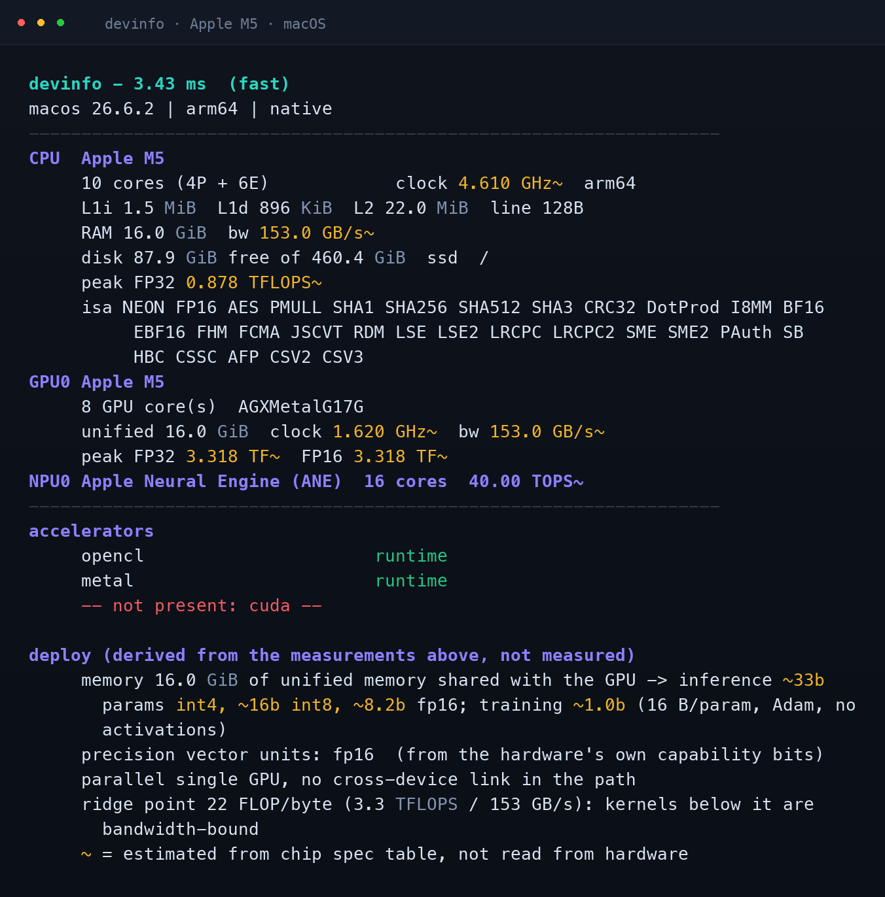
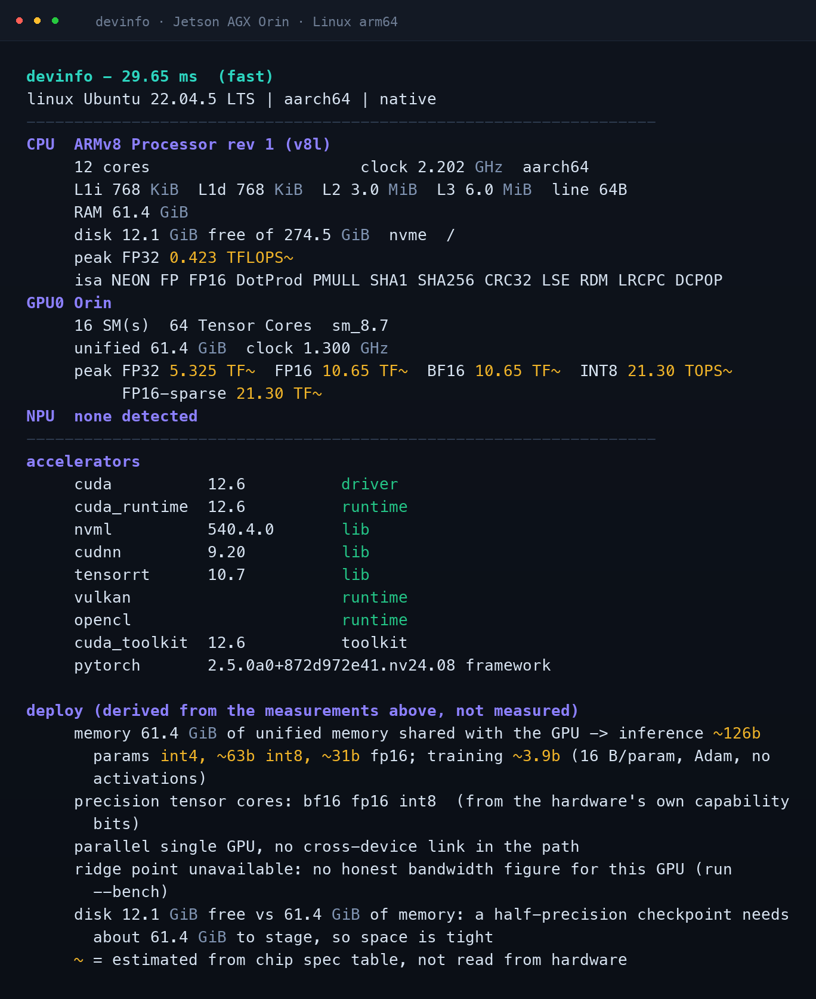
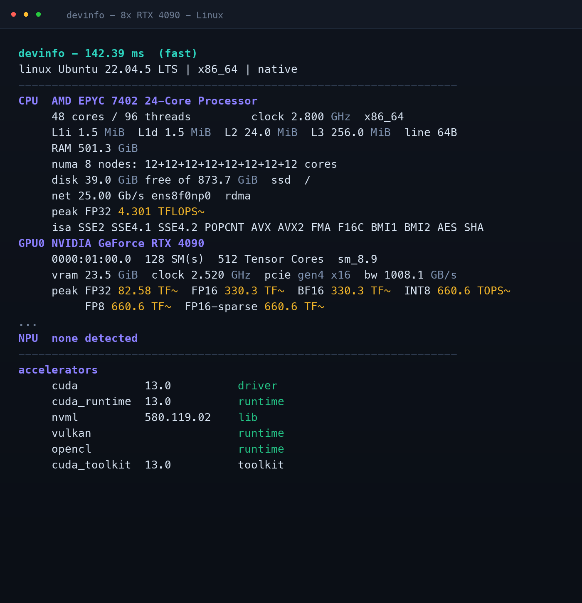

<p align="center">
  <b>devinfo</b><br>
  One binary that reads the real hardware of any machine<br>
  <sub>no subprocess · no vendor SDK · 3 ms</sub>
</p>

<p align="center">
  <b>English</b> &nbsp;｜&nbsp; <a href="README.md">中文</a>
</p>

<p align="center">
  
  
  
  
  
</p>

> Drop one statically linked C++17 binary onto a machine nobody administered, run it once, and it reports: how many cores and how much cache the CPU has, which ISA extensions it supports, how many SMs and tensor cores the GPU has, its architecture, VRAM and bandwidth, the NPU's throughput, which acceleration stacks are installed, what PCIe generation is on the link, and **how large a model this box can hold**.
>
> 3 milliseconds. Zero third-party dependencies. Zero subprocesses.

## 🖼️ Output

| Apple M5 · macOS arm64 | Jetson AGX Orin · Linux aarch64 |
|:---:|:---:|
|  |  |

| 2× EPYC 7402 + 8× RTX 4090 · Linux x86_64 |
|:---:|
|  |

Numbers marked `~» are **derived from a chip spec table**, not read from the hardware, and are rendered in amber. Nothing is filled in.

### Static site

The repo ships a static site with no CDN dependency: full measured records, raw output, screenshots.

```bash
python3 -m http.server 19090 --directory site
# open http://127.0.0.1:19090/
```

`site/index.html» is the product page, `site/results.html» the measured record for four real machines. The raw-output blocks are generated by `tools/build_results.py» straight from `assets/captures/*.txt», so the page cannot drift from what the binary actually printed.

## 📝 What it is

devinfo answers the questions you must answer **before** deploying, and it only answers the ones it can actually read:

- Is this card **sm_89** or **sm_87**? Can it do FP8?
- Is that **23.5 GiB of dedicated VRAM** or **61.4 GiB of unified memory**? The second one cannot be counted as VRAM.
- Do those 8 cards form **one 186.6 GiB pool**, or are they **two different models that can only run separate jobs**?
- Is bandwidth **1008 GB/s**, or was it simply not readable? Is the roofline knee at 82 FLOP/byte, or not computable at all?
- Does this box have **CUDA 13.0 + cuDNN 9.20 + TensorRT 10.7**, or just a driver?
- I am inside a container: of the 96 cores I can see, **how many may I actually use**?

Three exits: a table for humans (`--table»), JSON for programs (`--json»), and a C ABI for other languages (`libdevinfo.so» / `.dylib» / `devinfo.dll»).

## ✨ What it reads

### 1. CPU and caches

- Physical cores and threads, with performance/efficiency split (Apple Silicon, Intel 12th gen and later);
- L1i / L1d / L2 / L3 and the cache line size;
- Clocks: the measured value when readable, otherwise a spec-table figure marked `~»;
- Full ISA bitmap: x86 from SSE2 / SSE4.1 / **SSE4.2** / AVX / AVX2 / AVX-512 / FMA / AES / SHA; ARM from NEON / FP16 / DotProd / I8MM / BF16 / SVE / SME / SME2;
- NUMA node layout.

Peak FP32 is **cores × GHz × flops-per-cycle**, where flops-per-cycle follows the ISA (AVX-512 = 64, AVX2 = 32, SSE/NEON = 16 FLOP/cycle). That is why the number is not half of what it should be.

### 2. GPU and NPU

- Model, PCI address, PCI ID (the `1002:6987» kind that matches driver support lists);
- **SM count**, **tensor core count**, compute capability (`sm_8.9»);
- VRAM size, and whether it is **dedicated** or **unified** (decided by CUDA's `integrated» attribute, not guessed from the model name);
- Memory clock, bus width, and the resulting bandwidth;
- Per-precision peaks: FP32 / FP16 / BF16 / INT8 / FP8 / FP16-sparse, derived from the architecture's tensor core spec;
- NPU: Apple ANE core count and TOPS, Ascend / Cambricon through the CANN loader.

### 3. Acceleration stacks

`dlopen» only -- never linked, never executed:

| Stack | How |
|---|---|
| CUDA / cuDNN / TensorRT / NCCL / NVML | `libcudart» / `libcudnn» / `libnvinfer» / `libnccl» / `libnvidia-ml», version from a symbol or a file |
| ROCm / HIP | `libamdhip64», `librocblas» |
| CANN (Ascend) | `libascendcl», `libcann» |
| Cambricon | `libcnrt», `libcndev» |
| OpenVINO / OpenCL / Vulkan / Metal / DirectML | platform APIs |
| PyTorch / Conda environments | file reads only |

Every entry carries its **provenance**: `driver» / `runtime» / `lib» / `toolkit» / `framework». You can tell a driver-bundled runtime from a pip install.

### 4. Bandwidth and links

- VRAM bandwidth = bus width ÷ 8 × effective clock × 2 (GDDR double-pumped), dedicated memory only;
- **PCIe reports maximum capability, not the idle-downclocked value** -- a parked 4090 drops to gen1, and reporting gen1 would be wrong;
- `--bench» measures real memcpy bandwidth, replacing an estimate with a measurement;
- The roofline knee is peak throughput ÷ bandwidth; kernels below it are bandwidth-bound.

### 5. Deployment derivation

Conclusions derived from the measured memory, precision support and bandwidth -- labelled as derived, never as measured:

- Model capacity at `int4» / `int8» / `fp16»;
- Training capacity (16 B/param, Adam state, no activations);
- **Whether the memory can be pooled**: only identical models form a pool; heterogeneous cards are called out explicitly;
- Parallelism: whether all 8 cards are x16 and whether tensor parallel fits inside PCIe;
- Whether the disk can stage a half-precision checkpoint.

### 6. Containers and limits

- cgroup v1 / v2: `cpu.max», `memory.max», `cpuset.cpus.effective»;
- Windows job object CPU and memory limits;
- Free disk space resolved through the real mount point, so an overlay `/» inside a container still maps correctly.

## ⚡ Why it is fast

| Rule | Consequence |
|---|---|
| **Never spawn a process** | `nvidia-smi», `npu-smi», `lspci», `wmic» are all excluded. Each costs 200-800 ms and needs a PATH plus permissions |
| **Never link a vendor SDK** | CUDA / NVML / cuDNN / TensorRT / NCCL / ROCm / CANN / OpenCL are resolved with `dlopen» / `LoadLibrary» at run time. A box without drivers is a normal box, not a crash |
| **Never create a device context** | CUDA is asked only for `cuDeviceGetAttribute»; no context, no Metal device, no D3D12 device. `cuInit» alone costs over 100 ms |
| **One pass, no polling** | This is a snapshot, not a monitor. No sampling thread, no timers, no background work |

The result: **3.43 ms** on macOS, **29.65 ms** on a Jetson Orin, **142 ms** on a dual EPYC box with 8× 4090 (almost all of it spent in `cuInit» bringing up 8 devices).

## 🧪 Measured

The same binary, on four very different machines:

| Machine | Arch | CPU | GPU | Memory | Probe |
|---|---|---|---|---|---|
| Apple M5 · macOS 26.6 | arm64 | 10 cores (4P+6E) | 8 GPU cores · ANE 40 TOPS | 16.0 GiB unified | **3.43 ms** |
| 2× EPYC 7402 + 8× RTX 4090 | x86_64 | 48C/96T | 8 × 23.5 GiB · sm_8.9 | 501.3 GiB | 142 ms |
| Jetson AGX Orin 64GB | aarch64 | 12 cores | 16 SM / 64 TC · sm_8.7 | 61.4 GiB unified | 29.65 ms |
| Dell OptiPlex 7090 · Win11 | x86_64 | i7-11700 8C/16T | UHD 750 + RX 640 | 63.7 GiB | 199 ms |

Full record, raw output per machine, and the known limits: [site/results.html](site/results.html).

The 8-GPU figure moves with machine load (117-163 ms observed): nearly all of it is `cuInit» bringing up 8 devices, which cannot be parallelised. The per-card queries can: 13-22 ms serially, about 3 ms across threads. The table quotes the run behind the capture file, not the best result.

## 🎯 No invention

This is the hardest rule in the project, and the one most worth keeping.

**If it cannot be read, it does not get a number.** Dressing up "could not read it" as "estimated" is worse than saying nothing: someone budgets VRAM with it and gets the wrong answer.

| Case | What happens |
|---|---|
| Integrated GPU | No "VRAM bandwidth", because an iGPU shares the memory bus and has no such quantity |
| Jetson LPDDR5 bandwidth | Not copied from a spec table; the deploy block says `ridge point unavailable: no honest bandwidth figure for this GPU (run --bench)» |
| Linux without root | The SMBIOS table is unreadable, so memory speed is not reported (`/sys/firmware/dmi/tables/DMI» is root-only) |
| Windows turbo | `CallNtPowerInformation» returned only the base clock, so no "estimated turbo" is invented |
| PCIe on non-NVIDIA | No reliable source, so it is left blank |

Every derived value also appears in the JSON `estimated» array, so programmatic consumers can tell measurement from inference at a glance.

## 🚀 Quick start

### Build

One C++17 compiler and CMake ≥ 3.16. Nothing else:

```bash
cmake -B build -DCMAKE_BUILD_TYPE=Release
cmake --build build -j
```

Artifacts:

| File | What |
|---|---|
| `build/devinfo» (`devinfo.exe» on Windows) | CLI, statically linked |
| `build/libdevinfo.so» / `.dylib» / `devinfo.dll» | the C ABI plugin |

macOS builds a **universal binary** (`arm64 + x86_64») by default; Windows builds for both 32-bit and 64-bit.

### Run

```bash
./build/devinfo              # terminal → table, pipe → JSON
./build/devinfo --table      # force the table
./build/devinfo --json       # force JSON
./build/devinfo --bench      # add a real memory bandwidth measurement
./build/devinfo --version
```

When double-clicked on Windows it writes `devinfo-report.txt» and `devinfo-report.json» next to itself and exits, instead of flashing a console and vanishing.

### C ABI

Four exported symbols, header `include/devinfo.h»:

```c
#define DEVINFO_ABI_VERSION 1u
#define DEVINFO_VERSION_STRING "1.0.0"
#define DEVINFO_FAST  0u   /* structural only */
#define DEVINFO_BENCH 1u   /* + memory bandwidth micro-benchmark */

uint32_t    devinfo_abi_version(void);
const char* devinfo_version(void);
char*       devinfo_probe_json(uint32_t flags);   /* malloc'd JSON, NULL on OOM */
void        devinfo_free(char* p);                /* NOT free() -- on Windows they differ */
```

The JSON document *is* the ABI contract, so the header can stay frozen: no structs cross the boundary and there is nothing to version-fight over.

From Python, with no bindings:

```python
import ctypes, json

lib = ctypes.CDLL("./build/libdevinfo.so")
lib.devinfo_probe_json.restype = ctypes.c_void_p
lib.devinfo_probe_json.argtypes = [ctypes.c_uint]
lib.devinfo_free.argtypes = [ctypes.c_void_p]

p = lib.devinfo_probe_json(0)
data = json.loads(ctypes.string_at(p).decode("utf-8"))
lib.devinfo_free(p)

for gpu in data["gpus"]:
    print(gpu["name"], gpu.get("vram_gib"), gpu.get("sm_count"))
```

See `examples/ffi_c.c» and `examples/ffi_python.py».

## 📊 Support matrix

| Item | Linux | macOS | Windows |
|---|---|---|---|
| CPU model / cores / caches | `/proc» + CPUID | `sysctl» | CPUID + `GetLogicalProcessorInformationEx» |
| Hybrid P/E topology | — | ✅ | ✅ CPU Sets |
| ISA bitmap | CPUID | `sysctl» | CPUID |
| Memory size | `/proc/meminfo» | `sysctl» | `GlobalMemoryStatusEx» |
| Memory speed / channels | SMBIOS (needs root) | — | SMBIOS (no admin needed) |
| NVIDIA GPU | NVML / CUDA `dlopen» | ✅ | ✅ |
| Apple GPU | — | IOKit + Metal | — |
| Other GPUs | sysfs PCI | — | DXGI |
| NPU | CANN / Cambricon `dlopen» | ANE | not detected |
| PCIe link | NVML / sysfs | — | NVML (NVIDIA only) |
| Disk | `statvfs» + `/sys/block» | `statfs» | `GetDiskFreeSpaceEx» |
| Network | enumerate `/sys/class/net» | — | not implemented |
| Container limits | cgroup v1 / v2 | — | job object |

## 📁 Layout

| Path | Contents |
|---|---|
| `src/core.cpp» | platform-neutral normalisation, peak derivation, deploy derivation, JSON assembly |
| `src/linux.cpp» / `apple.cpp» / `win32.cpp» | three independent platform collectors |
| `src/capi.cpp» | thin C ABI wrapper (4 symbols) |
| `src/emit.cpp» / `table.cpp» | table rendering, NV architecture spec table |
| `src/main.cpp» | CLI flags and double-click handling |
| `include/devinfo.h» | **public C ABI header** (frozen) |
| `include/devinfo_core.hpp» | internal data model (`Num» with provenance) |
| `site/» | static site and measured record |
| `assets/captures/» | real stdout captures; screenshots and the results page are generated from them |
| `tools/» | screenshot renderer, results-page generator |
| `dist/» | prebuilt binaries per platform |

## 🔍 Known limits

Not a to-do list -- places where the program currently cannot read, or cannot read fully. They are listed so you know which column to trust:

- **Linux memory speed needs root**: the SMBIOS table lives in `/sys/firmware/dmi/tables/DMI», root-only;
- **Windows reports base clock only**: `CallNtPowerInformation» did not return turbo on that machine;
- **PCIe on non-NVIDIA is not reported**: only NVML gives link generation and width reliably;
- **No bandwidth for integrated GPUs**: the iGPU shares the memory bus;
- **Windows network and disk media are not implemented**: needs SetupAPI plus IOCTL work;
- **Windows re-test pending**: the six issues found in the first real Windows run (missing SSE4.2, halved CPU peak, heterogeneous VRAM summed, training capacity shown as `~0b», poor heterogeneous-parallel wording, HIP mislabelled as a ROCm version) are all fixed, but that machine is currently unreachable, so the post-fix numbers are unverified.

## 📌 Status

Verified on four real machines (Apple Silicon, dual EPYC with 8 GPUs, Jetson, an Intel desktop) and builds with zero warnings on every platform.

Still unverified: an MSVC build (the Windows binaries are cross-compiled with llvm-mingw), and the Windows re-test above.

## 📄 License

Apache License 2.0. The full text is in [LICENSE](LICENSE).
