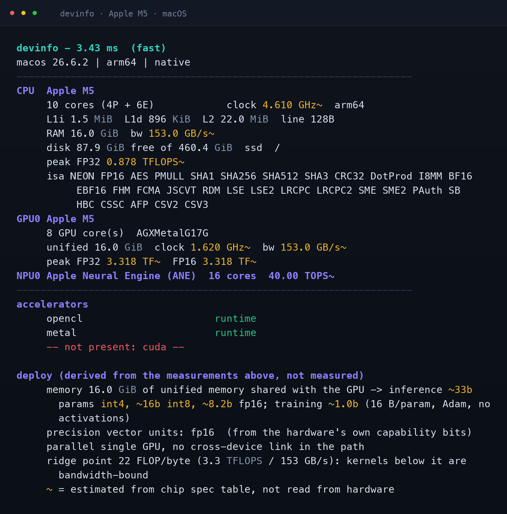
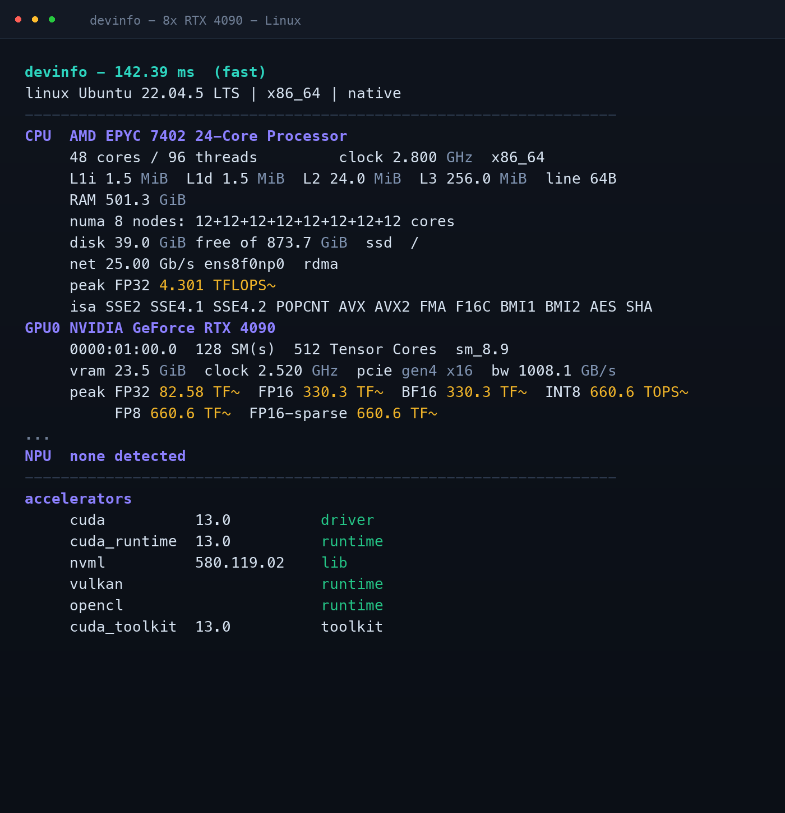
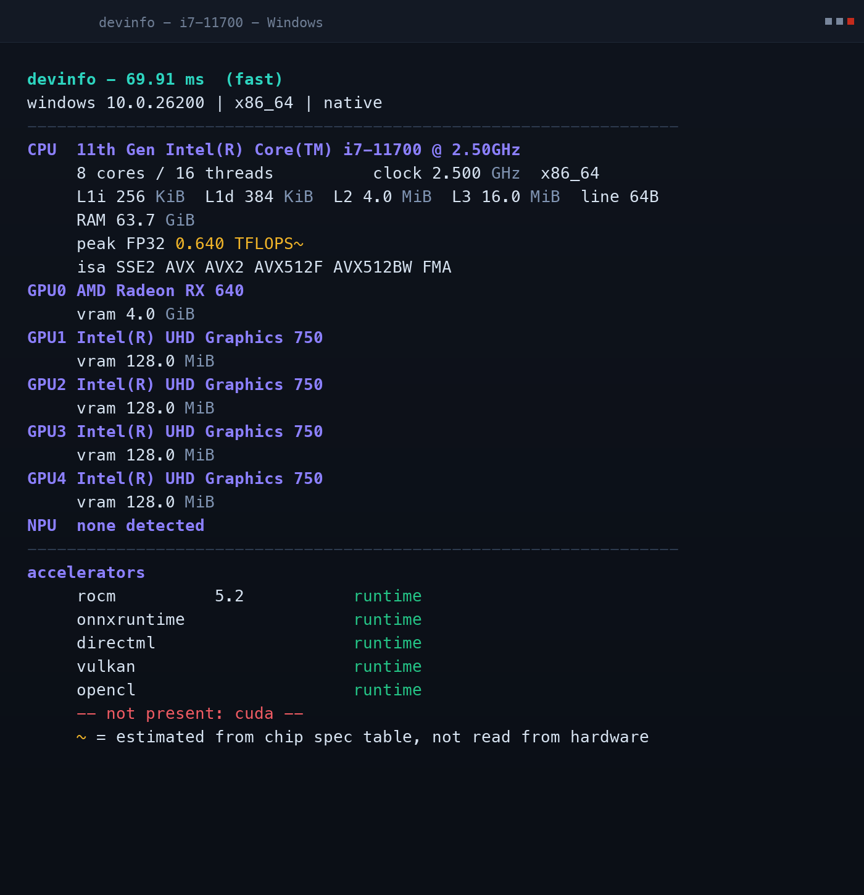

<p align="center">
  <b>devinfo</b><br>
  一个二进制，读出任何机器真实的硬件<br>
  <sub>不启子进程 · 不链厂商 SDK · 不用安装 · 毫秒级</sub>
</p>

<p align="center">
  <a href="README.md">English</a> &nbsp;｜&nbsp; <b>中文</b>
</p>

<p align="center">
  
  
  
  
  
  
</p>

> 我总是一次次站到没人写清楚过的机器前面：借来的显卡机、放在别人桌上的边缘盒子、一个明明有 96 核却只让我用 8 核的容器。想知道"这台里面到底有什么"，过去要三个不同的工具，其中两个还跟我要 root。
>
> 所以我写了一个二进制。扔到机器上跑一次，它就告诉我：CPU 有多少核、多大缓存、支持哪些指令集；GPU 有多少 SM 和 Tensor Core、什么架构、多大显存、多少带宽；NPU 多少算力；装了哪些加速栈；链路上是 PCIe 几代；以及**这台机器实际能装下多大的模型**。

## 🖥️ 三个平台，一个二进制

<table>
<tr>
<td width="33%" valign="top">
<p align="center"><b>macOS</b><br><sub>11+ &middot; Apple Silicon 与 Intel &middot; 同一个 universal 二进制</sub></p>
<p align="center"><a href="https://zhipingwoods.github.io/devinfo/#output"></a></p>
<p><sub>我用 `sysctl` 与 IOKit 读拓扑、缓存和带宽，用 Metal 读 GPU，ANE 核心数从系统拿。不需要装任何东西。</sub></p>
</td>
<td width="33%" valign="top">
<p align="center"><b>Linux</b><br><sub>x86_64 与 aarch64 &middot; 容器里也能跑</sub></p>
<p align="center"><a href="https://zhipingwoods.github.io/devinfo/#output"></a></p>
<p><sub>sysfs 与 procfs、NUMA、`cpufreq`、cgroup 限额；通过 `dlopen` 调 CUDA 驱动 API；PCIe 走 sysfs。不用 root，不用装任何东西。</sub></p>
</td>
<td width="33%" valign="top">
<p align="center"><b>Windows</b><br><sub>10 与 11 &middot; x64 与 x86</sub></p>
<p align="center"><a href="https://zhipingwoods.github.io/devinfo/#output"></a></p>
<p><sub>CPUID 读核心与指令集，DXGI 读显卡与显存，SetupAPI 读 NPU，NVML 补 NVIDIA 细节。一个 `.exe`，无运行时、无安装包。</sub></p>
</td>
</tr>
</table>

同样的输出、同样的 JSON：不用按平台挑版本，不启子进程，不走 WMI，不在机器上装厂商 SDK，不要管理员权限。国产芯片——鲲鹏、飞腾、龙芯、兆芯——我让它们走同一套代码路径；Jetson Orin 对我来说就是台普通的 aarch64 Linux。

## ⬇️ 下载

每个"系统 + 架构"组合打一个包，文件名本身就回答了"这台机器能不能跑"：

| 平台 | 架构 | 文件 | 内容 |
|---|---|---|---|
| **Windows** | x86_64 | [devinfo-1.0.0-windows-x64.zip](https://github.com/ZhipingWoods/devinfo/raw/main/release/devinfo-1.0.0-windows-x64.zip) | `devinfo.exe` + `devinfo.dll` |
| **Windows** | i686，32 位 | [devinfo-1.0.0-windows-x86.zip](https://github.com/ZhipingWoods/devinfo/raw/main/release/devinfo-1.0.0-windows-x86.zip) | `devinfo.exe` + `devinfo.dll` |
| **macOS** | universal：一个二进制含 arm64 + x86_64 | [devinfo-1.0.0-macos-universal.dmg](https://github.com/ZhipingWoods/devinfo/raw/main/release/devinfo-1.0.0-macos-universal.dmg) | `devinfo` + `libdevinfo.dylib` |
| **macOS** | 同上，zip 版 | [devinfo-1.0.0-macos-universal.zip](https://github.com/ZhipingWoods/devinfo/raw/main/release/devinfo-1.0.0-macos-universal.zip) | 同上 |
| **Linux** | x86_64 | [devinfo-1.0.0-linux-x86_64.tar.gz](https://github.com/ZhipingWoods/devinfo/raw/main/release/devinfo-1.0.0-linux-x86_64.tar.gz) | `devinfo` + `libdevinfo.so` |
| **Linux** | aarch64 | [devinfo-1.0.0-linux-aarch64.tar.gz](https://github.com/ZhipingWoods/devinfo/raw/main/release/devinfo-1.0.0-linux-aarch64.tar.gz) | `devinfo` + `libdevinfo.so` |

解开直接跑 `./devinfo`（Windows 上是 `devinfo.exe`），每个包里都带一份简短的 `README.txt`。同样的文件也放在 [`release/`](release/)，想自己从源码构建也行。

## 📋 例子

一台笔记本、一台 8 卡 Linux、一个边缘模块。以下都是真实输出，直接从 [results.html](https://zhipingwoods.github.io/devinfo/results.html) 里那几次运行抄下来的：

**Apple M5 · macOS 26.6 · arm64** —— 3.4 ms

```text
devinfo - 3.43 ms  (fast)
macos 26.6.2 | arm64 | native
CPU  Apple M5
     10 cores (4P + 6E)            clock 4.610 GHz~  arm64
     L1i 1.5 MiB  L1d 896 KiB  L2 22.0 MiB  line 128B
     RAM 16.0 GiB  bw 153.0 GB/s~
     peak FP32 0.878 TFLOPS~
GPU0 Apple M5
     8 GPU core(s)  AGXMetalG17G
     unified 16.0 GiB  clock 1.620 GHz~  bw 153.0 GB/s~
     peak FP32 3.318 TF~  FP16 3.318 TF~
NPU0 Apple Neural Engine (ANE)  16 cores  40.00 TOPS~
deploy (derived from the measurements above, not measured)
     memory 16.0 GiB of unified memory shared with the GPU -> inference ~33b
```

**2× EPYC 7402 + 8× RTX 4090 · Ubuntu 22.04 · x86_64** —— 八张卡，一张一张单独问

```text
GPU0 NVIDIA GeForce RTX 4090
     0000:01:00.0  128 SM(s)  512 Tensor Cores  sm_8.9
     vram 23.5 GiB  clock 2.520 GHz  pcie gen4 x16  bw 1008.1 GB/s
     peak FP32 82.58 TF~  FP16 330.3 TF~  BF16 330.3 TF~  INT8 660.6 TOPS~
          FP8 660.6 TF~  FP16-sparse 660.6 TF~
GPU1 NVIDIA GeForce RTX 4090
     0000:23:00.0  128 SM(s)  512 Tensor Cores  sm_8.9
     ...
```

**Jetson AGX Orin 64GB · L4T R36.4 · aarch64** —— 报出共享内存模型，而不是编一个显存数字

```text
GPU0 Orin
     unified 61.4 GiB  clock 1.300 GHz
     peak FP32 5.325 TF~  FP16 10.65 TF~  INT8 21.30 TOPS~
NPU  none detected
accelerators
     cuda          12.6          driver
     tensorrt      10.7          runtime
deploy (derived from the measurements above, not measured)
     memory 61.4 GiB of unified memory shared with the GPU -> inference ~126b
```

带 `~` 的数字是从芯片规格表推出来的，不是从硬件读到的；JSON 里它们单独列在 `estimated` 数组。空着的格子就是空着，我不往里填数。
## 🗺️ 待办 —— 也是我能用上你的地方

这是一个人做的项目，下面这些是我明确知道还缺的。哪一条正好是你擅长的问题，开个 issue 或者直接发 PR —— 我宁愿多看一份补丁，也不想再一个人写一个平台探测。

- [ ] **在 Windows 上再跑一次。** 上面那张 Windows 截图是那台机器第一轮测试的结果；它暴露的六个问题都修了，但我还没回到那台机器上。任何一台 Windows 10/11 的输出——截图或者 JSON——都比我再读一遍代码有用。
- [ ] **Windows 的网络和磁盘介质。** 需要 SetupAPI 加几个 IOCTL，这是三个平台最后还不一致的地方。
- [ ] **MSVC 构建。** 我发布的 Windows 二进制是用 llvm-mingw 交叉编译的。我想知道它在 MSVC 下能不能编译，如果不能，也想知道是哪些警告。
- [ ] **签名。** 现在下载下来的副本会被 SmartScreen 和 Gatekeeper 各警告一次。Authenticode 和公证能解决，但我没有证书可测。
- [ ] **规格表补更多条目。** 昇腾 910B、寒武纪 MLU、壁仞、海光 DCU：代码路径都在，但我从来没有过这些硬件，所以那几张卡报出来的信息比我期望的少。
- [ ] **aarch64 的 Windows 构建**，以及给 C ABI 一个打包好的入口——把那四个符号包成一个小 wheel，装它就能用 `pip install`。
- [ ] **分发。** `brew`、`winget`、`scoop` 的清单。二进制已经是静态链接的，缺的只是打包这一步。

## 🤝 参与贡献

这个项目是故意做小的：没有第三方依赖，不启子进程，不链厂商 SDK，一个平台一个文件。下面几条规矩维持着这个状态，靠的是 review 而不是 CI：

1. **一个数字必须能说清来历。** 加探测代码，就在同一个 patch 里说明这个值是怎么读到的。读不到就别写——不要把它"估算"进表格。`include/devinfo_core.hpp` 里的 `Num` 带 `has` 和 `estimated`，就是为了这件事。
2. **不要启子进程。** `nvidia-smi`、`lspci`、`wmic` 这类一律不行，"就调一次"也不行。
3. **不要链厂商 SDK。** 运行时用 `dlopen` / `LoadLibrary`，永远。一台没装驱动的机器也要能打出报告。
4. **不要创建设备上下文**，除非平台强制。`cuInit` 本身就要 100 ms 左右，上下文更贵。

上手：

```bash
git clone https://github.com/ZhipingWoods/devinfo
cd devinfo
cmake -B build -DCMAKE_BUILD_TYPE=Release
cmake --build build -j
./build/devinfo --table
```

如果你要给实测记录添一台机器，把原始 stdout 放进 `assets/captures/`，再跑 `tools/render_shots.py`。截图和结果页都是从那些文件生成的，所以站点不会和程序真正打印出来的东西走散。

一台我没见过的机器的原始输出，价值和一个补丁差不多：鲲鹏、寒武纪、老 Xeon、手机，什么都行。

## 📝 我想让它回答的问题

devinfo 回答的是我**部署之前**必须定下来的问题，而且只回答它真能读到的：

- 这张卡是 **sm_89** 还是 **sm_87**？能做 FP8 吗？
- 那是 **23.5 GiB 独立显存**，还是 **61.4 GiB 统一内存**？后者不能当显存算。
- 这 8 张卡是**一个 186.6 GiB 的池子**，还是**两个型号只能各跑各的**？
- 带宽是 **1008 GB/s**，还是根本读不到？roofline 拐点在 82 FLOP/byte，还是压根算不出来？
- 这台机器装的是 **CUDA 13.0 + cuDNN 9.20 + TensorRT 10.7**，还是只有个驱动？
- 我在容器里：看得见 96 核，**实际能用几个**？

三个出口：给人看的表格（`--table`）、给程序看的 JSON（`--json`）、给别的语言用的 C ABI（`libdevinfo.so` / `.dylib` / `devinfo.dll`）。

## ✨ 它读什么

### 1. CPU 与缓存

- 物理核与线程数，含性能核/能效核拆分（Apple Silicon、Intel 12 代及以后）；
- L1i / L1d / L2 / L3 和 cache line 大小；
- 频率：能读到就用实测值，读不到才用规格表的值并标 `~`；
- 完整指令集位图：x86 从 SSE2 / SSE4.1 / **SSE4.2** / AVX / AVX2 / AVX-512 / FMA / AES / SHA；ARM 从 NEON / FP16 / DotProd / I8MM / BF16 / SVE / SME / SME2；
- NUMA 节点布局。

峰值 FP32 = **核数 × 频率 × 每周期浮点操作数**，每周期操作数按指令集算（AVX-512 = 64，AVX2 = 32，SSE/NEON = 16 FLOP/cycle）。所以这个数不会只有应有值的一半。

### 2. GPU 与 NPU

- 型号、PCI 地址、PCI ID（形如 `1002:6987`，能直接对驱动支持列表）；
- **SM 数量**、**Tensor Core 数量**、计算能力（`sm_8.9`）；
- 显存大小，以及它是**独立**还是**统一内存**（由 CUDA 的 `integrated` 属性决定，不靠型号名猜）；
- 显存频率、位宽，以及由此算出的带宽；
- 各精度峰值：FP32 / FP16 / BF16 / INT8 / FP8 / FP16-sparse，由该架构的 Tensor Core 规格推出；
- NPU：Apple ANE 的核数与 TOPS，昇腾与寒武纪通过 CANN loader 读。

### 3. 加速栈

只用 `dlopen` —— 不链接、不执行：

| 栈 | 怎么读 |
|---|---|
| CUDA / cuDNN / TensorRT / NCCL / NVML | `libcudart` / `libcudnn` / `libnvinfer` / `libnccl` / `libnvidia-ml`，版本从符号或文件读 |
| ROCm / HIP | `libamdhip64`、`librocblas` |
| CANN（昇腾） | `libascendcl`、`libcann` |
| 寒武纪 | `libcnrt`、`libcndev` |
| OpenVINO / OpenCL / Vulkan / Metal / DirectML | 平台 API |
| PyTorch / Conda 环境 | 只读文件 |

每一条都带**来历**：`driver` / `runtime` / `lib` / `toolkit` / `framework`。驱动自带的运行时和 pip 装的是能分清的。

### 4. 带宽与链路

- 显存带宽 = 位宽 ÷ 8 × 有效频率 × 2（GDDR 双沿），只对独立显存算；
- **PCIe 报的是最大能力，不是降频后的当前值** —— 闲着的 4090 会掉到 gen1，报 gen1 是错的；
- `--bench` 做真实 memcpy 带宽测量，把估算换成实测；
- roofline 拐点 = 峰值算力 ÷ 带宽；落在拐点以下的 kernel 是带宽受限的。

### 5. 部署推导

这些是我从实测到的内存、精度支持和带宽**推**出来的结论——标注为推导，绝不会写成实测：

- `int4` / `int8` / `fp16` 下的模型容量；
- 训练容量（16 B/参数，Adam 状态，不含激活）；
- **显存能不能合并**：只有同型号才能成一个池，异构卡会明确点出来；
- 并行方式：8 张卡是不是都 x16，张量并行放不放得进 PCIe；
- 磁盘放不放得下半精度 checkpoint。

### 6. 容器与限额

- cgroup v1 / v2：`cpu.max`、`memory.max`、`cpuset.cpus.effective`；
- Windows job object 的 CPU 与内存限额；
- 可用磁盘按真实挂载点解析，所以容器里 overlay 的根目录也能对上。

## ⚡ 为什么快

我没有优化它，我只是把慢的东西删掉了。

| 规矩 | 后果 |
|---|---|
| **绝不启动子进程** | `nvidia-smi`、`npu-smi`、`lspci`、`wmic` 全部排除。每一个要 200-800 ms，还依赖 PATH 和权限 |
| **绝不链接厂商 SDK** | CUDA / NVML / cuDNN / TensorRT / NCCL / ROCm / CANN / OpenCL 全部运行时用 `dlopen` / `LoadLibrary` 解析。没装驱动的机器是正常机器，不是崩溃 |
| **绝不创建设备上下文** | 对 CUDA 只问 `cuDeviceGetAttribute`；不建上下文，不建 Metal device，不建 D3D12 device。光是 `cuInit` 就要 100 ms 以上 |
| **一趟扫完，不轮询** | 这是快照，不是监控。没有采样线程，没有定时器，没有后台任务 |

结果是：macOS 上 **3.43 ms**，Jetson Orin 上 **29.65 ms**，双 EPYC 加 8 张 4090 上 **142 ms**（几乎全花在 `cuInit` 把 8 张卡拉起来）。

## 🧪 实测

同一个二进制，跑在四台完全不同的机器上：

| 机器 | 架构 | CPU | GPU | 内存 | 探针耗时 |
|---|---|---|---|---|---|
| Apple M5 · macOS 26.6 | arm64 | 10 核（4P+6E） | 8 GPU 核 · ANE 40 TOPS | 16.0 GiB 统一 | **3.43 ms** |
| 2× EPYC 7402 + 8× RTX 4090 | x86_64 | 48C/96T | 8 × 23.5 GiB · sm_8.9 | 501.3 GiB | 142 ms |
| Jetson AGX Orin 64GB | aarch64 | 12 核 | 16 SM / 64 TC · sm_8.7 | 61.4 GiB 统一 | 29.65 ms |
| Dell OptiPlex 7090 · Win11 | x86_64 | i7-11700 8C/16T | UHD 750 + RX 640 | 63.7 GiB | 199 ms |

完整记录、每台机器的原始输出、以及已知边界：[results.html](https://zhipingwoods.github.io/devinfo/results.html)。

8 卡那个数字会随机器负载浮动（观察到 117-163 ms）。几乎全在 `cuInit` 拉起 8 张卡，这一步没法并行；单卡查询可以，串行 13-22 ms，多线程约 3 ms。表里写的是采集文件对应的那一次，不是我见过的最好成绩。

## 🎯 不编数字

这是我在这里最在意的一条规矩，也是我最希望你用来要求我的一条。

**读不到，就不给数字。** 把"读不到"包装成"估算"，比什么都不说更糟：有人拿它去算显存，就会算错。

| 情况 | 实际做法 |
|---|---|
| 核显 | 不写"显存带宽"，因为核显共享内存总线，根本不存在这个量 |
| Jetson 的 LPDDR5 带宽 | 不从规格表抄，部署段直接写 `ridge point unavailable: no honest bandwidth figure for this GPU (run --bench)` |
| 没 root 的 Linux | SMBIOS 表读不到，就不报内存频率（`/sys/firmware/dmi/tables/DMI` 只有 root 能读） |
| Windows 的睿频 | `CallNtPowerInformation` 只返回了基础频率，那就不编一个"估算睿频" |
| 非 NVIDIA 的 PCIe | 没有可靠来源，就留空 |

每一个推导值同时出现在 JSON 的 `estimated` 数组里，所以程序化的使用方一眼就能分辨实测和推断。

## 🚀 快速开始

### 构建

一个 C++17 编译器加 CMake ≥ 3.16，别的都不要：

```bash
cmake -B build -DCMAKE_BUILD_TYPE=Release
cmake --build build -j
```

产物：

| 文件 | 是什么 |
|---|---|
| `build/devinfo`（Windows 上是 `devinfo.exe`） | 静态链接的 CLI |
| `build/libdevinfo.so` / `.dylib` / `devinfo.dll` | C ABI 插件 |

macOS 默认产出 **universal 二进制**（`arm64 + x86_64`）；Windows 同时产出 32 位和 64 位。我用的交叉编译工具链放在 [`cmake/`](cmake/)。

### 运行

```bash
./build/devinfo              # 终端 -> 表格，管道 -> JSON
./build/devinfo --table      # 强制表格
./build/devinfo --json       # 强制 JSON
./build/devinfo --bench      # 加一次真实的内存带宽测量
./build/devinfo --version
```

在 Windows 上双击运行时，它会在自己旁边写出 `devinfo-report.txt` 和 `devinfo-report.json` 然后退出，而不是闪一下黑框就没了。

### C ABI

四个导出符号，头文件 [`include/devinfo.h`](include/devinfo.h)：

```c
#define DEVINFO_ABI_VERSION 1u
#define DEVINFO_VERSION_STRING "1.0.0"
#define DEVINFO_FAST  0u   /* 只做结构探测 */
#define DEVINFO_BENCH 1u   /* 加一次内存带宽微基准 */

uint32_t    devinfo_abi_version(void);
const char* devinfo_version(void);
char*       devinfo_probe_json(uint32_t flags);   /* malloc 出来的 JSON，OOM 时返回 NULL */
void        devinfo_free(char* p);                /* 不是 free() —— Windows 上两者不同 */
```

JSON 文档**就是** ABI 契约，所以头文件可以冻住：没有结构体跨边界，也就没有版本打架的余地。

从 Python 调用，不需要任何绑定：

```python
import ctypes, json

lib = ctypes.CDLL("./build/libdevinfo.so")
lib.devinfo_probe_json.restype = ctypes.c_void_p
lib.devinfo_probe_json.argtypes = [ctypes.c_uint]
lib.devinfo_free.argtypes = [ctypes.c_void_p]

p = lib.devinfo_probe_json(0)
data = json.loads(ctypes.string_at(p).decode("utf-8"))
lib.devinfo_free(p)

for gpu in data["gpus"]:
    print(gpu["name"], gpu.get("vram_gib"), gpu.get("sm_count"))
```

见 [`examples/ffi_c.c`](examples/ffi_c.c) 与 [`examples/ffi_python.py`](examples/ffi_python.py)。

## 📊 支持矩阵

各平台今天能读到什么。横杠表示我在那个平台上还没实现，其中好几条就在上面的待办里。

| 项目 | Linux | macOS | Windows |
|---|---|---|---|
| CPU 型号 / 核心 / 缓存 | `/proc` + CPUID | `sysctl` | CPUID + `GetLogicalProcessorInformationEx` |
| 性能核/能效核拓扑 | — | ✅ | ✅ CPU Sets |
| 指令集位图 | CPUID | `sysctl` | CPUID |
| 内存大小 | `/proc/meminfo` | `sysctl` | `GlobalMemoryStatusEx` |
| 内存频率 / 通道 | SMBIOS（要 root） | — | SMBIOS（不要管理员） |
| NVIDIA 显卡 | NVML / CUDA `dlopen` | ✅ | ✅ |
| Apple 显卡 | — | IOKit + Metal | — |
| 其它显卡 | sysfs PCI | — | DXGI |
| NPU | CANN / 寒武纪 `dlopen` | ANE | 未检测 |
| PCIe 链路 | NVML / sysfs | — | NVML（仅 NVIDIA） |
| 磁盘 | `statvfs` + `/sys/block` | `statfs` | `GetDiskFreeSpaceEx` |
| 网络 | 枚举 `/sys/class/net` | — | 未实现 |
| 容器限额 | cgroup v1 / v2 | — | job object |

## 📁 目录

| 路径 | 内容 |
|---|---|
| `src/core.cpp` | 跨平台归一化、峰值推导、部署推导、JSON 组装 |
| `src/linux.cpp` / `apple.cpp` / `win32.cpp` | 三个互相独立的平台采集器 |
| `src/capi.cpp` | 很薄的 C ABI 包装（4 个符号） |
| `src/emit.cpp` / `table.cpp` | 表格渲染、NV 架构规格表 |
| `src/main.cpp` | 命令行参数与双击处理 |
| `include/devinfo.h` | **公开的 C ABI 头文件**（已冻结） |
| `include/devinfo_core.hpp` | 内部数据模型（带来历的 `Num`） |
| `site/` | 静态站点与实测记录 |
| `assets/captures/` | 真实 stdout 采集；截图和结果页由它们生成 |
| `tools/` | 截图渲染器、结果页生成器、打包脚本 |
| `release/` | 六个打包好的下载 |

## 🔍 已知边界

这不是待办清单——待办在上面。下面这些是程序**读不到**或**读不全**的地方，写出来是为了让你知道哪一列可以信：

- **Linux 内存频率需要 root**：SMBIOS 表在 `/sys/firmware/dmi/tables/DMI`，只有 root 能读；
- **Windows 只报基础频率**：在我测的那台机器上，`CallNtPowerInformation` 没返回睿频；
- **非 NVIDIA 的 PCIe 不报**：只有 NVML 能可靠给出链路代数和宽度；
- **核显没有带宽数字**：核显共享内存总线；
- **Windows 的网络和磁盘介质还没实现**：需要 SetupAPI 加 IOCTL。

## 📌 状态

它跑在四台真机上——Apple Silicon、双 EPYC 八卡、Jetson、一台 Intel 台式机——并且在我有编译器的每个平台上都是零警告构建。

我知道还没做完的部分都写在上面那份待办里。我宁愿把它们摆出来，也不愿意说成已经做完了。

## 📄 许可

Apache License 2.0，全文见 [LICENSE](LICENSE)。

---

如果这个工具替你省了一次 `nvidia-smi` 和一次 `lscpu`，那你能回赠我的最有用的东西，就是一台我没碰过的机器的原始输出。
